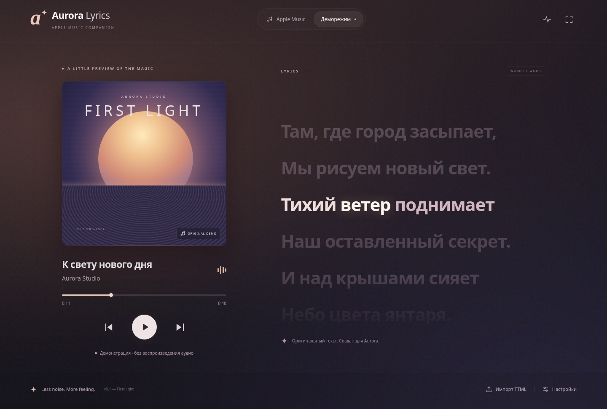

# Aurora Lyrics · v0.1

Apple Music Companion для Windows 11: собственное окно с крупным синхронизированным текстом, пословной подсветкой и фоном по цвету обложки. Музыку воспроизводит **официальное приложение Apple Music**. Aurora не получает аудиофайлы и не обходит DRM.



*Скриншот браузерного деморежима; реальная интеграция Windows проверяется отдельно.*

## Быстрый запуск

Готовые unsigned `.exe` собирает workflow **Validate and package Windows**. После успешного задания `windows` скачайте артефакт **Aurora-Lyrics-Windows-x64** во вкладке Actions: в нём установщик `…-nsis.exe` и portable `…-portable.exe`. Для запуска нужен Windows 11 x64. .NET runtime устанавливать отдельно не нужно: мост self-contained. Наличие workflow не означает, что удалённая сборка уже прошла; проверяйте результат конкретного запуска.

Установщик устанавливает приложение для текущего пользователя и предлагает выбрать каталог; portable запускается без установки. Подпись сертификатом в v0.1 не настроена: Windows может показать предупреждение SmartScreen. Не отключайте системную защиту; используйте доверенный источник или сборку из проверенного исходного кода.

1. Откройте Apple Music для Windows и включите композицию.
2. Запустите Aurora Lyrics, выберите **Apple Music**.
3. Откройте **Диагностику подключения** (иконка пульса справа вверху): там реальные сессии Windows, метаданные, позиция и доступность команд.
4. Нажмите **Импорт TTML** и выберите собственный файл для текущего трека.

Если Apple Music не найдена, выберите **Деморежим**. В нём оригинальный текст и обложка, таймер на 40 секунд, пауза, перемотка и переход между фрагментами. **Демо не воспроизводит аудио.** Никакие токены и аккаунты для демо не нужны.

## Разработка

Нужны Node.js 24 LTS и npm. Для Windows-моста и Windows-сборки — .NET SDK 10 LTS. Используйте существующий checkout: каждая облачная задача уже изолирована, отдельный worktree не нужен.

```sh
npm ci
npx install-electron --no # скачать runtime Electron с проверкой контрольных сумм
npm run dev:web       # браузер: демо и TTML; без системной медиасессии
npm run dev           # Electron; на Windows сначала соберите мост
```

На Windows перед `npm run dev`:

```powershell
npm run bridge:build
npm run dev
```

Мост находится в `native/publish/win-x64/WindowsMediaBridge.exe`. Без него Electron предлагает деморежим. В обычном production-приложении dev-сервер и доступ в интернет не требуются.

```sh
npm run check         # ESLint, unit tests, TypeScript, Vite и Electron bundles
npx playwright install chromium
npm run test:e2e      # реальные браузерные сценарии
npm run dist:win      # на Windows: мост, приложение, NSIS и portable
```

Готовые сборки находятся в `release/`. Автоматическая подпись и публикация релизов не настроены. `npm run build` создаёт JS/CSS и Electron bundles, но не установщики. Мост — только Windows x64 в v0.1.

## TTML и синхронизация

Пример собственного текста: [examples/first-light.ttml](examples/first-light.ttml). Поддержаны `tt/body/div/p/span`, namespaces, `begin/end/dur`, `hh:mm:ss.mmm` и единицы `h`, `m`, `s`, `ms`, параллельные контейнеры `par`. Вложенные метки относительны началу родительского контейнера: у строки с `begin="5s"` слово с `begin="1s"` начинается на 6-й секунде. Для строки нужен конечный `end/dur` на ней или предке. Строки без временных меток слов подсвечиваются целиком; точные времена слов не выдумываются.

Импорт ограничен 2 МБ; DTD, сущности, frame/tick-тайминг, последовательные контейнеры `seq`, стили и сложные TTML-профили не поддерживаются. Некорректный файл показывает понятную ошибку и сохраняет предыдущий текст. Перекрывающиеся строки отображаются последовательно, при одновременном времени активной считается первая по началу; дуэты/несколько голосов пока не поддерживаются.

Текст привязывается к текущему ID трека **на время работы приложения**. После перезапуска импортируйте его снова. Смена песни сбрасывает подсветку; без текста показывается пустое состояние. Загрузка текста из сети не реализована.

В **Настройках** можно задать offset от −10 до +10 с (положительный показывает текст раньше), включить Reduce Motion и экономное качество. Предпочтения сохраняются локально. Если Windows не предоставляет позицию, Aurora не выдаёт искусственную синхронизацию за реальную. В v0.1.2 ползунок Aurora поддерживает системную перемотку, если Apple Music публикует соответствующую capability. Успех подтверждается новым timeline, а не движением ползунка. [Проверка перемотки](docs/SEEK_V0.1.2.md).

Проверка: деморежим → воспроизведение → пауза → перемотка к 25 с → слово «Небо» должно подсветиться сразу. Возобновление не должно учитывать время, проведённое на паузе. Повторите с offset +1 с и импортом примера.

Результаты проверок и ограничения текущей облачной сборки: [VALIDATION](docs/VALIDATION.md).

## Границы версии

Есть типы и точки расширения смысловых эффектов, Canvas/WebGL renderer, редактора назначений и будущих источников текста. **ИИ-анализатор и движок смысловых эффектов не реализованы.** Нет библиотеки Apple Music, Spotify, локальных аудиофайлов, эквалайзера, кроссфейда, компактного режима и виджетов.

Реальная интеграция с Apple Music требует ручного теста на Windows 11; компиляция моста и браузерное демо этого не доказывают. Отсутствующие поля зависят от того, что публикует Apple Music в GSMTC. Детали и чек-лист: [WINDOWS_TESTING](docs/WINDOWS_TESTING.md). Архитектура: [ARCHITECTURE](docs/ARCHITECTURE.md). Планы: [ROADMAP](docs/ROADMAP.md).

Весь исходный код, демонстрационный текст и CSS-обложка созданы для этого проекта. Код и ресурсы других lyric-плееров не копировались. Шрифты Apple не включены; используются системные шрифты. Лицензии зависимостей сохраняются в их пакетах.

Изменения v0.1.1 и условия источников: [V0.1.1](docs/V0.1.1.md).
